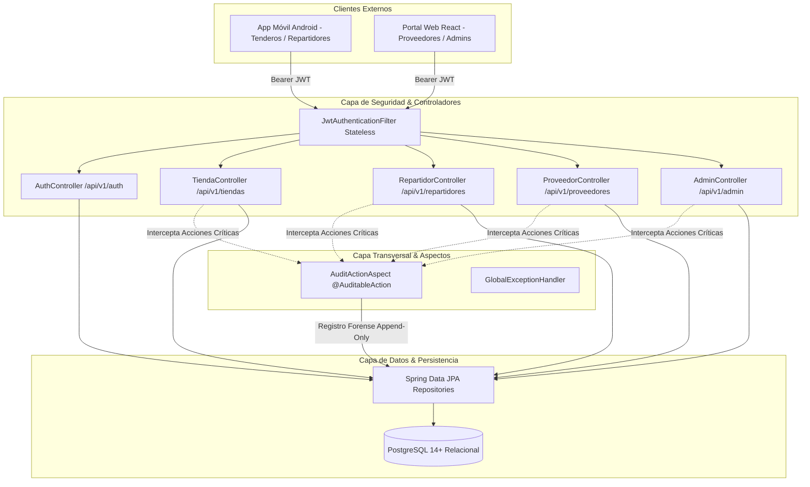

# PRISMA Backend API REST (Spring Boot 3.3.4 / Java 21)

[](https://openjdk.org)
[](https://spring.io/projects/spring-boot)
[](https://spring.io/projects/spring-security)
[](https://www.postgresql.org)
[](http://localhost:8080/swagger-ui.html)
[](LICENSE)

Motor transaccional central de la plataforma PRISMA (B2B Marketplace & Supply Chain). Desarrollado con arquitectura limpia en capas, seguridad sin estado basada en JWT, soporte multi-tenant para empresas de consumo masivo (CPG) y auditoría forense inmutable mediante programación orientada a aspectos (AOP).

---

## Arquitectura y Principios de Diseño



### Características Técnicas Destacadas:
1. **Multi-Tenancy por Datos:** Aislamiento lógico estricto donde cada empresa proveedora (ej. Coca-Cola, Postobón) solo tiene acceso a sus propios productos, camiones, pedidos y liquidaciones.
2. **Auditoría Forense Inmutable (Append-Only):** Mediante la anotación personalizada `@AuditableAction` y Spring AOP, cualquier cambio sensible (override de PIN, cambios de estado, reprogramaciones) queda grabado con el usuario responsable, IP, justificación y un diff JSON del antes y después.
3. **Flujo de Entrega con Cierre Criptográfico:** Los pedidos solo pueden marcarse como entregados mediante el PIN secreto generado para el tendero, o mediante anulación supervisada en la mesa de ayuda.

---

## Stack Tecnológico y Dependencias

| Módulo / Librería | Versión | Propósito |
| :--- | :--- | :--- |
| **OpenJDK** | `21 LTS` | Runtime de alto rendimiento con Virtual Threads y mejoras de GC |
| **Spring Boot** | `3.3.4` | Framework empresarial con autoconfiguración y contenedores embebidos |
| **Spring Data JPA / Hibernate** | `3.3.4` | Capa ORM y mapeo objeto-relacional con optimización de consultas |
| **PostgreSQL Driver** | `42.7.4` | Conector nativo de base de datos relacional |
| **Spring Security & JJWT** | `6.x` / `0.12.6` | Autenticación y autorización basada en tokens JWT firmados (HMAC-SHA256) |
| **Spring AOP** | `3.3.4` | Intercepción declarativa para logs de auditoría forense sin contaminar la lógica de negocio |
| **SpringDoc OpenAPI** | `2.6.0` | Generación automática de especificación Swagger UI y OpenAPI v3 |

---

## Estructura del Código

```
backend/
├── pom.xml                                   # Configuración de dependencias Maven
├── mvnw / mvnw.cmd                           # Maven Wrapper ejecutable
├── services/                                 # Módulos auxiliares (auth-service)
└── src/main/
    ├── resources/
    │   └── application.properties            # Configuración de datasource, JPA, JWT y Swagger
    └── java/com/prisma/api/
        ├── PrismaBackendApplication.java     # Clase de arranque de la aplicación
        ├── aspect/                           # @AuditableAction y AuditActionAspect (AOP)
        ├── config/                           # SecurityConfig, CorsConfig, OpenApiConfig
        ├── controller/                       # Controladores REST organizados por rol
        │   ├── AuthController.java           # Login y verificación de identidad
        │   ├── TiendaController.java         # Catálogo, pedidos y reclamos del tendero
        │   ├── RepartidorController.java     # Rutas, manifiestos y confirmación con PIN
        │   ├── ProveedorController.java      # Productos, camiones, liquidaciones y tiendas
        │   └── AdminController.java          # Mesa de ayuda, override de PIN y auditoría
        ├── dto/                              # Objetos de transferencia de datos de Request/Response
        ├── entity/                           # Entidades JPA (Proveedor, Pedido, DetallePedido, etc.)
        ├── enums/                            # Enumeraciones de estado, roles y severidad
        ├── repository/                       # Interfaces Spring Data JPA
        └── security/                         # Proveedor de tokens JWT y filtros de autorización
```

---

## Modelo de Base de Datos (PostgreSQL)

El esquema relacional cuenta con 16 tablas diseñadas para integridad estricta, llaves foráneas y reglas de inmutabilidad:
* **Entidades Principales:** `proveedores`, `usuarios`, `tiendas`, `categorias`, `productos`, `inventarios_camion`.
* **Operación Logística:** `camiones`, `rutas`, `pedidos`, `detalles_pedido`, `historial_estados_pedido`.
* **Control y Resolución:** `disputas`, `pqrs`, `liquidaciones`, `configuraciones_sistema`, `auditoria_logs`.

Los scripts SQL oficiales se encuentran en la raíz del proyecto:
* `database/schema.sql`: Definición DDL con índices, constraints y checks.
* `database/seed_data.sql`: Datos semilla con proveedores reales (Coca-Cola, Postobón), tiendas, conductores y pedidos activos.

---

## Principales Endpoints de la API

| Método | Endpoint | Rol Requerido | Descripción |
| :--- | :--- | :--- | :--- |
| `POST` | `/api/v1/auth/login` | Público | Autenticación con email/teléfono y retorno de JWT |
| `GET` | `/api/v1/auth/me` | Autenticado | Obtener información del usuario en sesión |
| `GET` | `/api/v1/tiendas/catalogo/{proveedorId}` | `ROLE_TENDERO` | Consulta de catálogo y precios por proveedor |
| `POST` | `/api/v1/tiendas/pedidos` | `ROLE_TENDERO` | Creación de orden de compra multi-producto |
| `POST` | `/api/v1/tiendas/pedidos/repetir-ultimo` | `ROLE_TENDERO` | Duplicar el último pedido habitual en un solo clic |
| `GET` | `/api/v1/repartidores/mis-rutas/hoy` | `ROLE_REPARTIDOR` | Hoja de ruta y secuencia de despachos del día |
| `POST` | `/api/v1/repartidores/pedidos/{id}/confirmar-entrega`| `ROLE_REPARTIDOR` | Validación de PIN secreto del tendero |
| `GET` | `/api/v1/proveedores/mis-productos` | `ROLE_PROVEEDOR_ADMIN` | Gestión de inventario y catálogo del mayorista |
| `GET` | `/api/v1/proveedores/liquidaciones` | `ROLE_PROVEEDOR_ADMIN` | Reporte quincenal de comisión del 2.5% |
| `POST` | `/api/v1/admin/pedidos/{id}/override-pin` | `ROLE_PLATFORM_ADMIN` | Override de emergencia con registro en auditoría |
| `GET` | `/api/v1/admin/auditoria` | `ROLE_PLATFORM_ADMIN` | Consulta de registros forenses de acciones operativas |

---

## Instalación y Puesta en Marcha

### 1. Requisitos Previos
* **Java:** OpenJDK 21 LTS instalado y configurado en `JAVA_HOME`.
* **Base de Datos:** PostgreSQL 14+ activo (local, Docker o PostgreSQL gratuito en Neon.tech / Supabase).

### 2. Configurar Variables de Entorno (Opcional)
La aplicación cuenta con valores por defecto para desarrollo local, pero pueden sobreescribirse:

```bash
export DB_URL=jdbc:postgresql://localhost:5432/prisma_db
export DB_USER=prisma_user
export DB_PASSWORD=prisma_password_2026
export JWT_SECRET=404E635266556A586E3272357538782F413F4428472B4B6250645367566B5970
export PORT=8080
```

### 3. Compilación y Pruebas con Maven Wrapper
```bash
# Dar permisos de ejecución
chmod +x mvnw

# Compilar proyecto y verificar dependencias
./mvnw clean compile

# Ejecutar pruebas unitarias
./mvnw test
```

### 4. Iniciar el Servidor API
```bash
./mvnw spring-boot:run
```

### 5. Despliegue con Docker y Docker Compose
Puedes levantar la API Spring Boot junto a PostgreSQL y los datos semilla en un solo paso:

```bash
# Construir imagen y levantar servicios
docker compose up -d --build

# Ver logs en tiempo real
docker compose logs -f backend
```
El contenedor de la API estara disponible en `http://localhost:8080`.

Una vez iniciado, el servicio estará respondiendo en `http://localhost:8080`.

---

## Documentación Interactiva (Swagger UI)
* **Swagger UI:** [http://localhost:8080/swagger-ui.html](http://localhost:8080/swagger-ui.html)
* **OpenAPI v3 JSON:** [http://localhost:8080/api/docs](http://localhost:8080/api/docs)

---

## Equipo y Atribución
Desarrollado en el marco del curso de IETI (Ingeniería de Software y Tecnologías de Internet) en la Escuela Colombiana de Ingeniería Julio Garavito.

* **Licencia:** Apache 2.0 - Consulta el archivo [LICENSE](LICENSE) para más detalles.
